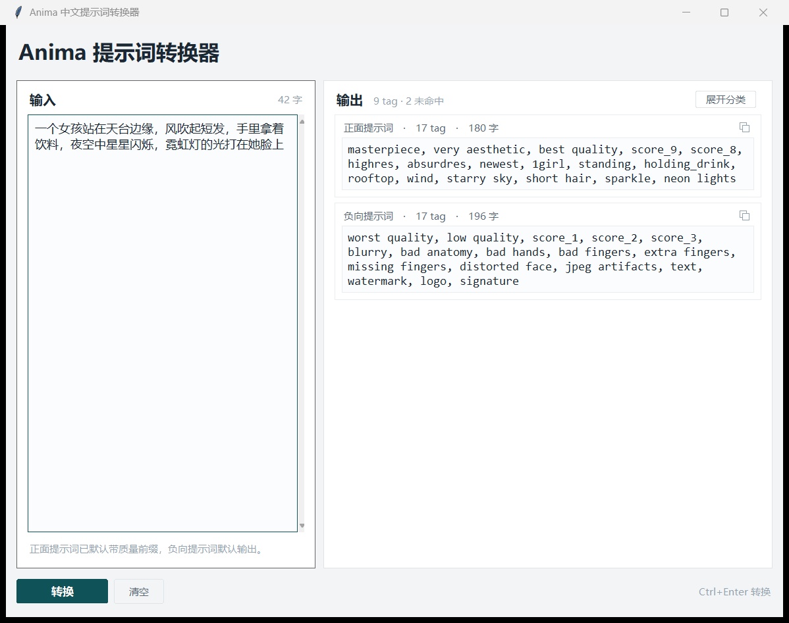
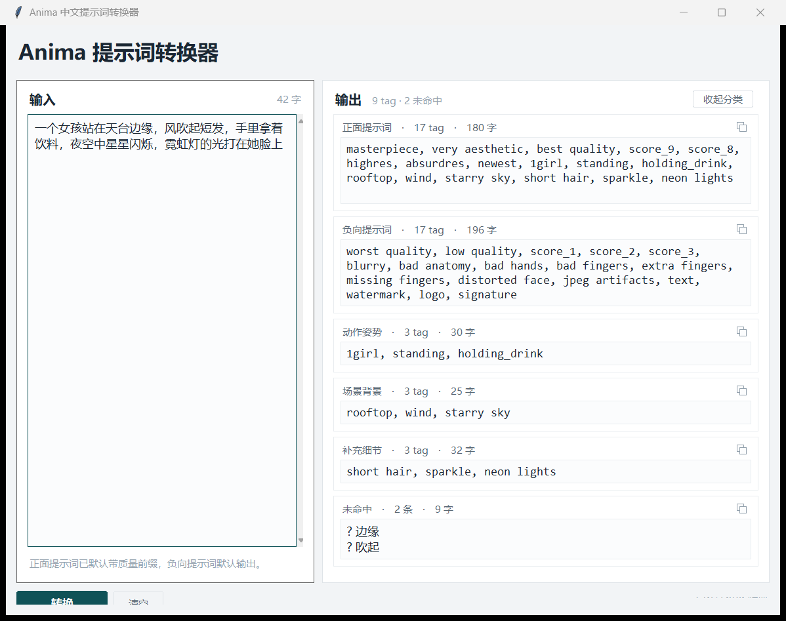

# Anima 中文提示词转换器

给 [ComfyUI](https://www.comfy.org/) 本地部署的 **Anima** 模型写提示词用的小工具：粘贴一段中文描述，输出规范化的 Danbooru tag，按「动作姿势 / 场景背景 / 补充细节」三组分开。

**完全离线、零第三方依赖、不调用任何大模型。**

[Anima](https://huggingface.co/circlestone-labs/Anima) 是 CircleStone Labs / Comfy Org 的二次元文生图模型，在 Danbooru 标签体系上训练。它同时接受 Danbooru tag、自然语言和两者混合，但用 **模型真正认识的 tag** 效果最稳 —— 这个工具解决的就是「中文 → 有效 tag」这一段。



<details>
<summary>展开分类的样子</summary>



</details>

## 三条铁律

1. **只翻译，不脑补。** 你写什么就转什么。没提到的概念，一个字都不会被加进去。
2. **不编造。** 中文词在词典里找不到对应 tag 时，原样列进「未命中」区，不猜、不替换。
3. **不联网。** 没有任何网络请求。

## 特性

- **三分类输出**：动作姿势 / 场景背景 / 补充细节
- **折叠 / 展开**：折叠给完整 prompt，展开追加分组明细
- **每张卡片自带复制按钮**，边框显示该卡的 tag 数与字数
- **词典经真实校验**：331 条英文 tag 全部逐条比对 Anima 官方 tag 表，0 条在表外
- **中英混输**：英文 tag 若词典认识会自动归到对应分组
- **零依赖**：仅用 Python 标准库（`tkinter` / `re` / `json`）

## 快速开始

### 1. 环境

- Python 3.9+（需含 `tkinter`，Windows 官方安装包默认自带）
- 无需 `pip install` 任何东西

### 2. 自备 Anima tag 表（重要）

词典校验工具需要 Anima 官方 tag 表 `Anima-preview.csv`。**这个文件不随仓库分发**，原因是它出自 GPL-3.0 许可的 [comfyui-good-anima](https://github.com/ComfyNodePRs/PR-Comfyui-Anima-tools-a0fe04bd) 技能包，打包进来会给本项目引入 GPL 传染。

工具会按这个顺序自动找它：

1. 命令行的 `--tags <路径>`
2. 环境变量 `ANIMA_TAGS`
3. `data/Anima-preview.csv`（推荐放这里）
4. 本机常见的 ComfyUI 技能包目录

拿到文件后放进 `data/` 即可。**只跑界面的话这一步可以跳过**——tag 表只被 `tools/` 下的校验脚本使用。

### 3. 运行

```bash
python anima_prompt.py
```

窗口里：粘贴中文 → 点「转换」→ 用卡片上的复制按钮取结果。`Ctrl+Enter` 触发转换，`Esc` 关窗口。

也可以用命令行：

```bash
python anima_prompt.py "一个女孩坐在教室窗边，回头看镜头微笑，午后阳光照进来，穿着校服，长发，逆光"
```

## 输出长什么样

输入：

```
一个女孩站在天台边缘，风吹起短发，手里拿着饮料，夜空中星星闪烁，霓虹灯的光打在她脸上
```

折叠态（默认）给完整 prompt：

```
masterpiece, very aesthetic, best quality, score_9, score_8, highres, absurdres, newest,
1girl, standing, holding_drink, rooftop, wind, starry sky, short hair, sparkle, neon lights
```

展开态追加分组明细：

| 分组 | 内容 |
| --- | --- |
| 动作姿势 | `1girl, standing, holding_drink` |
| 场景背景 | `rooftop, wind, starry sky` |
| 补充细节 | `short hair, sparkle, neon lights` |
| 未命中 | `边缘`、`吹起` |

## 分类口径

分类不看主观感觉，看 **Danbooru 官方 tag group**：

| 分组 | 收录内容 |
| --- | --- |
| 动作姿势 | 站坐躺跪、手臂手部、腿部、运动、动作产物、表情 |
| 场景背景 | 地点、房间、家具、天气、时间、环境物 |
| 补充细节 | 光影、服装、发型外貌、镜头视角、画质风格 |

`standing` / `sitting` 属 Action，`classroom` / `window` 属 Setting —— 这是 Danbooru 的既定分组。

## tag 是校验过的（这个项目最值钱的部分）

词典里 **331 条**英文 tag，全部逐条比对过 Anima 官方 tag 表：

```bash
python tools/check_tags.py
# 期望输出：不在 tag 表里的：0
```

**为什么必须校验**：Anima 的表是**筛选过的**，和完整 Danbooru 词表（33 万条）不是一回事。按常识写会踩大量坑：

| 常识写法 | Anima 表里有吗 | 实际应该用 |
| --- | --- | --- |
| `sofa` | 没有 | `couch` |
| `bangs` | 没有 | `blunt_bangs` / `parted_bangs` |
| `open_eyes` | 没有 | —— |
| `hand on hip` | 没有 | `hand_on_own_hip` |
| `swimming pool` | 没有 | `pool` |
| `from front` | 没有 | —— |
| `quiet` / `warm` / `romantic` / `cute` | **整个氛围词类别都没有** | —— |

本项目第一版词典按常识写了 340 条，拿去比对发现 **44 条 Anima 根本不认识**（13%）。靠 `tools/suggest_fixes.py` 反查候选、逐条替换或删除，才收敛到 0。**所以你拿到的每个 tag，模型都认识。**

### 格式约定

Anima 官方规范是**小写 + 空格**（不写下划线）：

```
looking at viewer     ✅
looking_at_viewer     ❌
```

工具输出的就是这个形式。

## 扩展词库

未命中的中文可以自己补映射。编辑 `data/user_dict.json`：

```json
{
  "中文词": ["分组", "english tag"],
  "温暖的感觉": ["补充细节", "warm lighting"],
  "猫娘": "cat girl"
}
```

只写英文 tag 字符串时默认归入「补充细节」。改完重启工具生效。

**加之前建议先验一下**：不在 Anima 表里的 tag 写了也白写。

```bash
python tools/check_tags.py        # 校验现有词典
python tools/suggest_fixes.py     # 为表外的 tag 反查近似候选
```

## 项目结构

```
anima-prompt-tool/
├─ anima_prompt.py          # 主程序：词典 + 匹配引擎 + 界面
├─ LICENSE                  # MIT
├─ README.md
├─ assets/
│  ├─ icon.ico              # 应用图标
│  └─ icon.png
├─ data/
│  └─ user_dict.json        # 你的扩展词库
├─ docs/                    # 界面截图 + 词典收敛记录
└─ tools/
   ├─ check_tags.py         # 校验词典 tag 是否都在 Anima 表内
   ├─ suggest_fixes.py      # 为表外的 tag 反查候选
   ├─ _tagtable.py          # tag 表定位器（被上面两个共用）
   ├─ ui_shot.py            # 抓界面截图（PrintWindow，被遮挡也能抓）
   └─ verify_shortcut.py    # 验证桌面快捷方式真能启动
```

如果想知道**词典为什么长成现在这样**，看 [`docs/词典收敛记录.md`](docs/词典收敛记录.md) —— 里面有 44 条 tag 的逐条取舍。

## 界面设计口径

不是随手配色，是按「长时间阅读中文文本」+「避免 LLM 默认审美」两条约束走的：

- **浅色冷灰基底**。不用纯黑，也不在浅色页里突然插深色块。文字色 `#1B2733` 比纯黑柔和。
- **只有一个强调色**：深青绿 `#0F5257`。分类卡的三个色是它的深浅变体，不引入第二个色相。
- **没有渐变、没有 AI 紫蓝**。「紫蓝渐变 + Inter + slate-900」是最典型的 AI 设计指纹，刻意避开。
- **字体分级**：中文用微软雅黑 UI，tag 与数字用 Consolas 等宽。
- **自绘控件**：系统 `Checkbutton` 会带一个 Web 蓝方块选择器，与配色打架，所以开关、按钮、卡片全部用 Canvas 画（圆角走平滑多边形近似）。

想换配色，改 `anima_prompt.py` 顶部的 `C` 字典，一个色值全局生效。

## 已知边界

- 中文分词靠**最长匹配**，不是真正的分词器。罕见表达会被拆成「部分命中 + 未命中」，未命中区会如实报出来。
- 复合短语如「天台边缘」只能命中「天台」，「边缘」进未命中。要精确匹配就往 `user_dict.json` 里加整条。
- 词典 331 条覆盖的是高频视觉概念，长尾词需要按需扩。
- 氛围词（安静的、温馨的、浪漫的）在 Anima 表里没有对应 tag，会落进未命中。Anima 支持自然语言，这类描述适合用英文短句写在 prompt 末尾。
- 窗口尺寸和位置不做记忆。

## 资源占用

纯 Python 标准库，词典 331 条常驻内存，启动毫秒级，**不占显存**。相比本地跑一个 LLM 做翻译，这是两个数量级的差距。

## 相比现成方案

查过一圈，现成的都只解决「点选 / 补全」：

- [ai-prompt-supermarket](https://github.com/BFRKQSB7/ai-prompt-supermarket) — 单文件 HTML，内置 31.7 万条中英对照，点选生成
- [小河的 Danbooru 标签助手](https://xhoxye.github.io/BooruTagCart/) — 浏览器端标签浏览
- [ffdkj 的 Danbooru 中英对照表](https://github.com/ffdkj/ffdkj-Danbooru_Tag-Chinese-English-Translation-Table) — 33 万条 sqlite / csv，MIT
- [Comfyui-Anima-Tools](https://github.com/ComfyNodePRs/PR-Comfyui-Anima-tools-a0fe04bd) — Anima 专用视觉提示词套件

它们都是「给你一个词库，你自己挑」。而本工具是「丢一段中文进去，直接出分类好的 prompt」，中间的分词、分类、未命中隔离没人做。

## 致谢

这个工具站在别人的数据上，明确记一笔：

- **[amenorira/danbooru-tags-data-zh](https://github.com/amenorira/danbooru-tags-data-zh)** — Danbooru 标签的中文翻译数据库，收录图片数 > 50 的标签，译名以社区通用叫法为准，同时发布在 GitHub 与 HuggingFace。**本项目的词库扩展方向依赖这份数据**（用于把覆盖量从当前的 331 条提升一个量级）。
- **[ffdkj/ffdkj-Danbooru_Tag-Chinese-English-Translation-Table](https://github.com/ffdkj/ffdkj-Danbooru_Tag-Chinese-English-Translation-Table)** — 每日更新的 Danbooru tag 中英对照表，33 万+ 条，含 `category`（标签分类）与 `post_count`，MIT 许可。**感谢作者持续维护这份数据并免费开放。**
- **[ComfyUI Good Anima](https://github.com/ComfyNodePRs/PR-Comfyui-Anima-Tools-a0fe04bd)** — 提供了 Anima 官方 tag 表 `Anima-preview.csv`，本项目的词典校验完全建立在它之上。
- **[Danbooru](https://danbooru.donmai.us/)** — 所有 tag 语义与分类的源头。
- **[CircleStone Labs](https://huggingface.co/circlestone-labs/Anima) / Comfy Org** — Anima 模型本身。

本项目的代码是 MIT，但上述数据的版权归各自作者所有，使用时请遵守其许可。

## 许可

[MIT](LICENSE)。

Anima 官方 tag 表 `Anima-preview.csv` 不包含在本仓库内，其版权归原项目所有，使用前请遵守其许可（GPL-3.0）。
